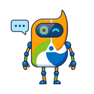
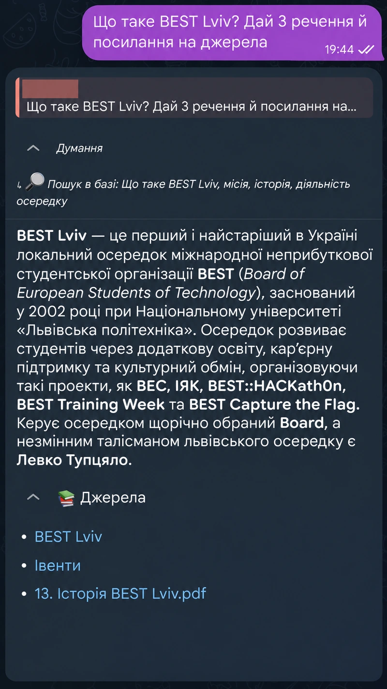
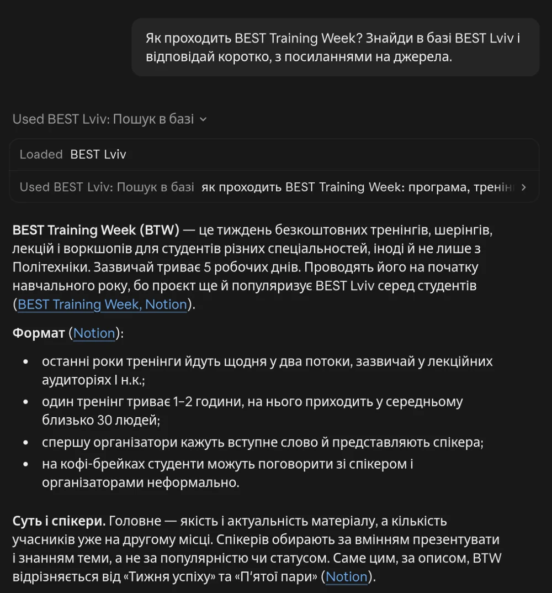
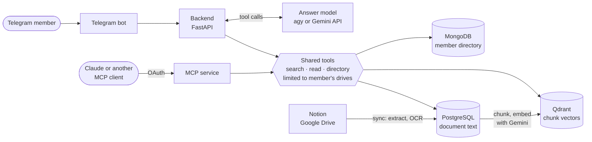

<p align="center">
  
</p>

<h1 align="center">Scribe</h1>

<p align="center">A Telegram assistant that answers questions from BEST Lviv members and links to its sources in Notion and Google Drive. Also available via MCP.</p>

<p align="center"><a href="#demo">Demo</a> · <a href="#architecture">Architecture</a> · <a href="#setup">Setup</a></p>

## Demo

Scribe answers questions about BEST Lviv in Ukrainian and links to the documents it used. The same knowledge base is available in Telegram and, through MCP, in assistants such as Claude.

<table>
  <tr>
    <th>Telegram</th>
    <th>Claude via MCP</th>
  </tr>
  <tr>
    <td valign="top"></td>
    <td valign="top"></td>
  </tr>
</table>

## Architecture



The Telegram bot streams answers from the backend, which runs the answer model and executes its tool calls. MCP clients bring their own model and call the same tools through the OAuth-protected MCP service.

During sync, the backend extracts content from Notion and Google Drive, stores the text in PostgreSQL, splits it into chunks, embeds them with Gemini and indexes them in Qdrant. PostgreSQL also keeps Telegram chat history, linked user accounts and MCP OAuth data. MongoDB holds the read-only member directory.

Search in Telegram and MCP uses the drives available to the member. The Telegram command `/drives` shows their drive access.

- **Rare names.** A single query embedding drives semantic search and extra queries filtered to individual rare names within the member’s allowed sources. Each filter gives matching chunks their own candidate pool before the backend deduplicates and ranks them. [Search implementation](backend/src/vectorstore/qdrant.py#L86-L144)
- **Index updates.** A sync copies unchanged points into a new collection and embeds changed chunks. The live search alias switches after the replacement collection is populated and passes a size check. [Reindexing](backend/src/vectorstore/qdrant.py#L260-L280) · [Alias switch](backend/src/vectorstore/qdrant.py#L323-L333)

The stack uses FastAPI, aiogram, LlamaIndex, Qdrant, PostgreSQL and MongoDB. The assistant began as an n8n workflow before its retrieval and indexing moved into Python. [Original n8n project](https://github.com/spiowm/n8n-infrastructure)

## Setup

Clone the repository with Docker and Compose installed, then copy the environment template.

```bash
cp .env-example .env
```

Fill in the following values in `.env`. The template provides a local `MCP_PUBLIC_URL` and a host-development `BACKEND_URL`.

| Service | Required values |
| --- | --- |
| Telegram | `BOT_TOKEN` |
| Internal API | `INTERNAL_API_TOKEN` (shared by the backend and bot) |
| PostgreSQL | `POSTGRES_PASSWORD` |
| Notion | `NOTION_TOKEN` |
| Google Drive | `GOOGLE_DRIVE_CREDENTIALS_JSON` (base64-encoded service-account JSON) |
| Gemini | `GEMINI_API_KEY` |
| Member directory | `MONGO_URI` |
| Cloudflare R2 | `R2_ACCOUNT_ID`, `R2_ACCESS_KEY_ID`, `R2_SECRET_ACCESS_KEY` |

If you are using your own knowledge base or directory, supply its IDs and names as described in [Deployment](docs/deployment.md#source-configuration).

```bash
docker compose up -d --build
```

Compose applies database migrations through the backend service. The internal API is at `http://localhost:8000` and the local MCP endpoint is at `http://localhost:8077/mcp`. For a custom bot, set its MCP URL and username as described in [Deployment](docs/deployment.md#source-configuration). Members can then use `/mcp_login` in Telegram to connect their account.

The default Telegram answer provider is Antigravity CLI (`agy`). Sign in using the [container keyring procedure](docs/deployment.md#sign-in-to-agy). Gemini API fallback is disabled by default. Document embeddings, query embeddings and Drive OCR use the Gemini API independently of the answer provider.

After configuring the sources, export the same `INTERNAL_API_TOKEN` used by Compose in your shell and run the sync endpoints. Sync can consume Gemini API quota.

```bash
curl --fail-with-body -X POST -H "X-Internal-Token: $INTERNAL_API_TOKEN" http://localhost:8000/sync/notion
curl --fail-with-body -X POST -H "X-Internal-Token: $INTERNAL_API_TOKEN" http://localhost:8000/sync/gdrive
```

For host development with `uv`, Coolify configuration and service troubleshooting, see [Deployment](docs/deployment.md).
