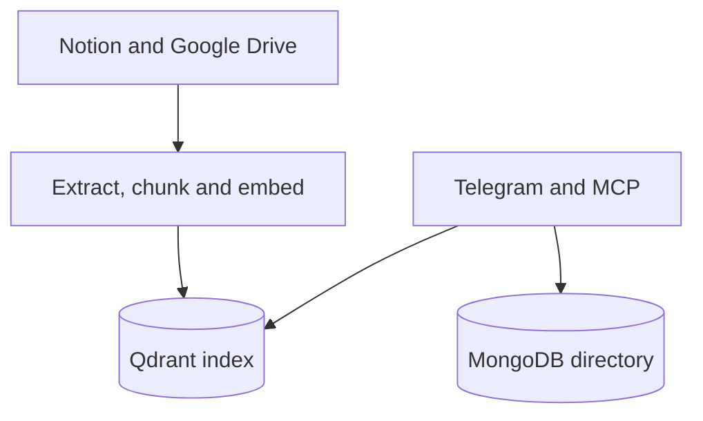

<p align="center">
  
</p>

<h1 align="center">Scribe</h1>

<p align="center">A Telegram assistant that answers questions from BEST Lviv members and links to its sources in Notion and Google Drive. Also available via MCP.</p>

<p align="center"><a href="backend/pyproject.toml"></a></p>

<p align="center"><a href="#demo">Demo</a> · <a href="#architecture">Architecture</a> · <a href="#setup">Setup</a></p>

## Demo

> **Member** · дай лінки на бестівські сайти
>
> **Scribe**
>
> - **BEST::HACKath0n**:
>   - Чинний/актуальний: [hack.best-lviv.org.ua](https://hack.best-lviv.org.ua/)
> - **BEC (Engineering Competition)**:
>   - Чинний: [bec.best-lviv.org.ua](https://bec.best-lviv.org.ua/)
> - **ІЯК (EJF — Engineering Job Fair)**:
>   - Чинний: [ejf.best-lviv.org.ua](https://ejf.best-lviv.org.ua/)

Excerpt from a Scribe conversation in Telegram showing the public event links in the reply.

## Architecture



The Telegram bot streams answers from the FastAPI backend. The OAuth-protected MCP service exposes search and directory tools so a connected client can retrieve the same source links. PostgreSQL stores user and chat state, OAuth data and extracted documents. MongoDB serves directory lookups independently of the document index.

- **Rare names.** A single query embedding drives semantic search and extra queries filtered to individual rare names. Each filter gives matching chunks their own candidate pool before the backend deduplicates and ranks them. [Search implementation](backend/src/vectorstore/qdrant.py#L41-L87)
- **Index updates.** A sync copies unchanged points into a new collection and embeds changed chunks. The live search alias switches after the replacement collection is populated and passes a size check. [Reindexing](backend/src/vectorstore/qdrant.py#L136-L156) · [Alias switch](backend/src/vectorstore/qdrant.py#L188-L198)

The stack uses FastAPI, aiogram, LlamaIndex, Qdrant, PostgreSQL and MongoDB. The assistant began as an n8n workflow before its retrieval and indexing moved into Python. [Original n8n project](https://github.com/spiowm/n8n-infrastructure)

## Setup

Clone the repository with Docker and Compose installed, then copy the environment template.

```bash
cp .env-example .env
```

Fill in the following values in `.env`. The template provides a local `MCP_PUBLIC_URL` and a host-development `BACKEND_URL`.

| Service | Required values |
| --- | --- |
| Telegram | `BOT_TOKEN` |
| PostgreSQL | `POSTGRES_PASSWORD` |
| Notion | `NOTION_TOKEN` |
| Google Drive | `GOOGLE_DRIVE_CREDENTIALS_JSON` (base64-encoded service-account JSON) |
| Gemini | `GEMINI_API_KEY` |
| Member directory | `MONGO_URI` |
| Cloudflare R2 | `R2_ACCOUNT_ID`, `R2_ACCESS_KEY_ID`, `R2_SECRET_ACCESS_KEY` |

If you are using your own knowledge base or directory, supply its IDs and names as described in [Deployment](docs/deployment.md#source-configuration).

```bash
docker compose up -d --build
```

Compose applies database migrations through the backend service. The internal API is at `http://localhost:8000` and the local MCP endpoint is at `http://localhost:8077/mcp`. For a custom bot, set its MCP URL and username as described in [Deployment](docs/deployment.md#source-configuration). Members can then use `/mcp_login` in Telegram to connect their account.

The default Telegram answer provider is Antigravity CLI (`agy`). Sign in using the [container keyring procedure](docs/deployment.md#sign-in-to-agy). Gemini API fallback is disabled by default. Document embeddings, query embeddings and Drive OCR use the Gemini API independently of the answer provider.

After configuring the sources, run the sync endpoints on the internal API to populate the index. Sync can consume Gemini API quota.

```bash
curl --fail-with-body -X POST http://localhost:8000/sync/notion
curl --fail-with-body -X POST http://localhost:8000/sync/gdrive
```

For host development with `uv`, Coolify configuration and service troubleshooting, see [Deployment](docs/deployment.md).
